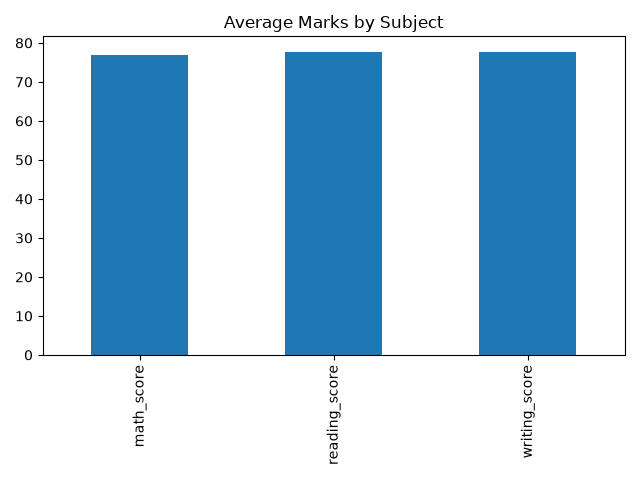
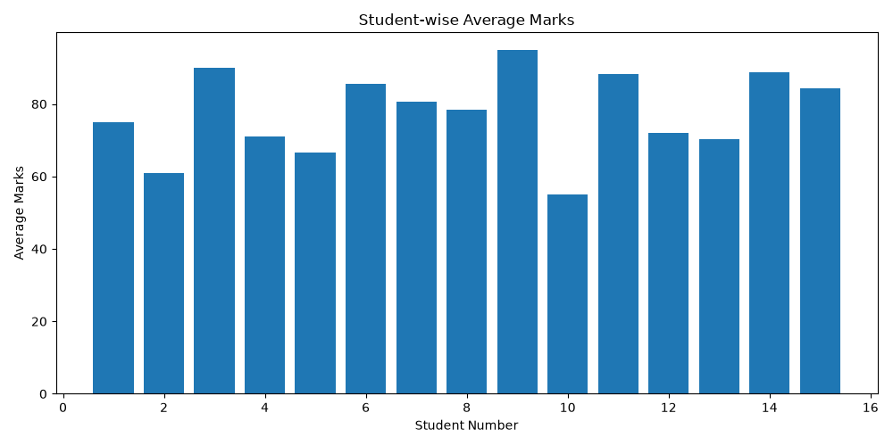

# Student Performance Analysis

## Project Overview

This project analyzes student marks in Mathematics, Reading, and Writing using Python.

The goal is to explore student performance, calculate average scores, and visualize the results.

## Technologies Used

- Python
- Pandas
- Matplotlib
- CSV

## Dataset

The project uses a sample dataset containing student marks and other information.
## Analysis Performed

- Loaded student data using Pandas.
- Calculated average marks for each student.
- Calculated subject-wise average marks.
- Compared performance across gender groups in the sample dataset.
- Identified the highest and lowest student averages.

## Visualizations

### 1. Average Marks by Subject

### 2. Student-wise Average Marks

## Key Findings

- Reading had the highest subject average (77.8).
- Writing had an average score of 77.6.
- Mathematics had an average score of 77.0.
- Female students had a higher average than male students in this sample dataset.

**Note:** These findings describe only the small sample dataset used in this project and should not be generalized to all students.